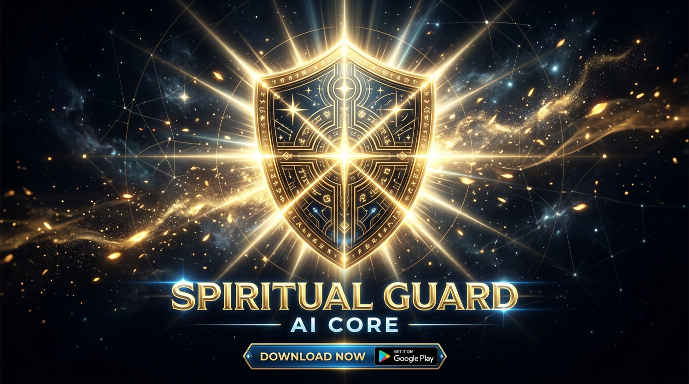
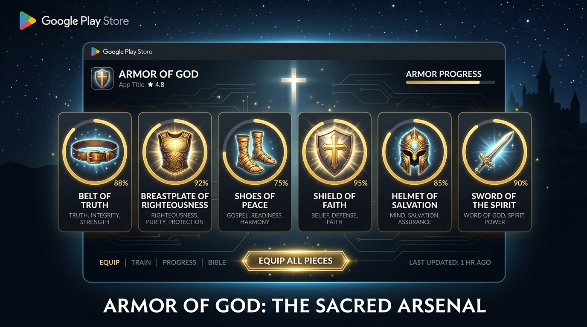
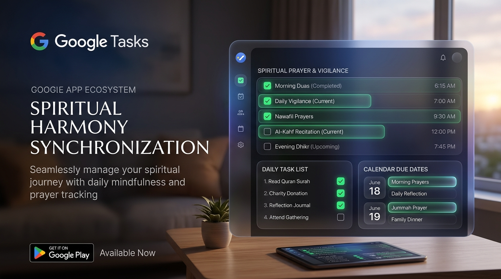
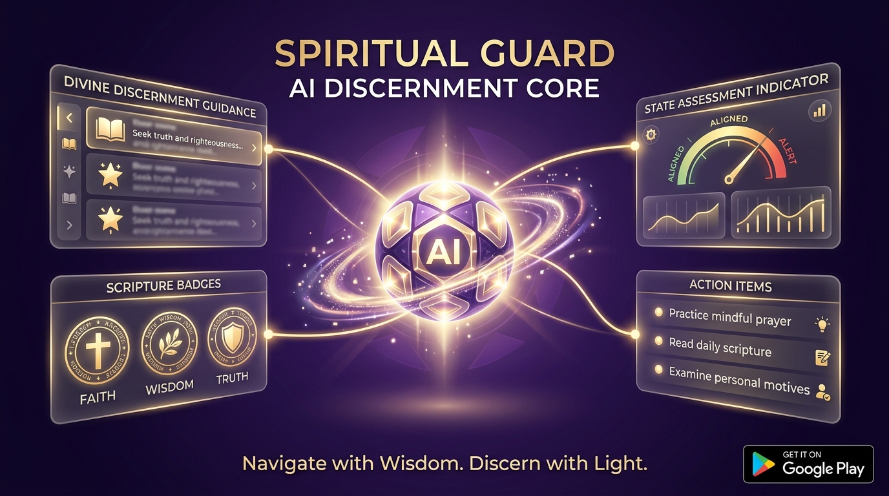

# 🛡️ Spiritual Guard AI Core

[](https://vitejs.dev/)
[](https://developers.google.com/tasks)
[](https://ai.google.dev/)
[](./proguard-rules.pro)
[](./SECURITY.md)

**Spiritual Guard AI Core** is an intelligent spiritual discernment and daily protection platform. It seamlessly unifies **Google Tasks** task management with scriptural armor vigilance (Ephesians 6:10-18), generative AI spiritual guidance via Google Gemini, and mindful contemplation.

---

## 📱 Google Play Store Showcase & Visual Assets

### 1. Official Google Play Feature Graphic

*Figure 1: The radiant Shield of Faith and celestial armor banner for Google Play.*

---

### 2. The Sacred Arsenal: Armor of God (Ephesians 6)

*Figure 2: Interactive Ephesians 6 Armor equipping dashboard with daily integrity tracking and 1-click Google Tasks sync.*

---

### 3. Google Tasks Real-Time Synchronization

*Figure 3: Two-way synchronization with official Google Tasks, custom lists, category tagging, and festive task celebrations.*

---

### 4. Spiritual Guard AI Discernment Core

*Figure 4: Gemini-powered discernment engine assessing spiritual atmospheres, emotional boundaries, and generating actionable vigilance habits.*

---

### 5. Sacred Vigil Contemplation Timer & Chimes

*Figure 5: Meditation timer with synthesized 432Hz/528Hz singing bowl and affirmation chimes using zero external audio files.*

---

## 🌟 Core Pillars & Capabilities

### 🛡️ 1. Google Workspace & Tasks Integration
- **Official Sign in with Google**: Adheres strictly to the Google Workspace integration design system.
- **In-Memory Token Caching**: OAuth access tokens are preserved solely in runtime memory and purged upon logout for maximum security.
- **Full Task Lifecycle**: Create, update, filter, toggle completion, and organize across multiple Google Tasks lists.
- **Destructive Operation Safety**: Mandatory confirmation modal dialogs protect against accidental task deletion or list clearing.
- **1-Click Equip**: Generates the complete 6-piece Ephesians 6 Armor of God routine directly into your Google Tasks with a single tap.

### 🕊️ 2. AI Discernment Core (Gemini 2.5 Flash)
- **Atmosphere Assessment**: Analyzes spiritual state, anxiety vs truth, and emotional boundary protection.
- **Scripture Grounding**: Connects each inquiry to timeless biblical wisdom and divine promises.
- **Actionable Task Converter**: Automatically converts AI guidance into scheduled tasks with context notes and deadlines.

### ⚔️ 3. Ephesians 6 Armor Contemplation
- **Belt of Truth**: Inner integrity and radical honesty.
- **Breastplate of Righteousness**: Guarding the heart and releasing offenses.
- **Shoes of Peace**: Steady footing and tranquil reconciliation.
- **Shield of Faith**: Extinguishing fiery darts of panic and despair.
- **Helmet of Salvation**: Guarding thoughts and renewing the mind.
- **Sword of the Spirit**: Proclaiming sacred words of life and promise.

### 🔔 4. Web Audio Synthesizer
- Built-in Web Audio API synthesizers provide authentic Tibetan singing bowls (432Hz fundamental + harmonic overtones) and affirmation bells (528Hz peace resonance) without external MP3/WAV assets.

---

## 🔒 Security & Compliance

Spiritual Guard AI Core is designed around strict privacy and least-privilege access:
- **Scope Minimization**: Only `https://www.googleapis.com/auth/tasks` is requested.
- **No Local Token Storage**: Access tokens are never saved to `localStorage`, `sessionStorage`, or cookies.
- **Server-Side API Proxy**: Gemini API keys are isolated on the backend server (`server.ts`) and never exposed to the client.
- **User Confirmation Required**: All mutating Workspace API calls require explicit user confirmation.

For full details, review [SECURITY.md](./SECURITY.md).

---

## 📦 ProGuard & Android Optimization

For Google Play Store and Android compilation, comprehensive optimization and obfuscation rules are defined in [proguard-rules.pro](./proguard-rules.pro):
- Preserves Google Play Services and Google Tasks client APIs.
- Protects Firebase Authentication callbacks and AppCheck integrity.
- Secures cryptographic providers and JavaScriptInterface bridges.

---

## 🚀 Getting Started

### Prerequisites
- Node.js 20+
- Google Cloud project with Google Tasks API enabled

### Installation
```bash
# Clone the repository
git clone https://github.com/example/spiritual-guard-ai-core.git
cd spiritual-guard-ai-core

# Install dependencies
npm install

# Start development server
npm run dev
```

### Production Build
```bash
npm run build
npm run start
```

---

## 📜 License & Acknowledgments

- **License**: Apache-2.0
- **Scriptural Basis**: Ephesians 6:10-18, Psalm 91, Philippians 4:6-7
- **Google Workspace API**: Google Tasks API v1
